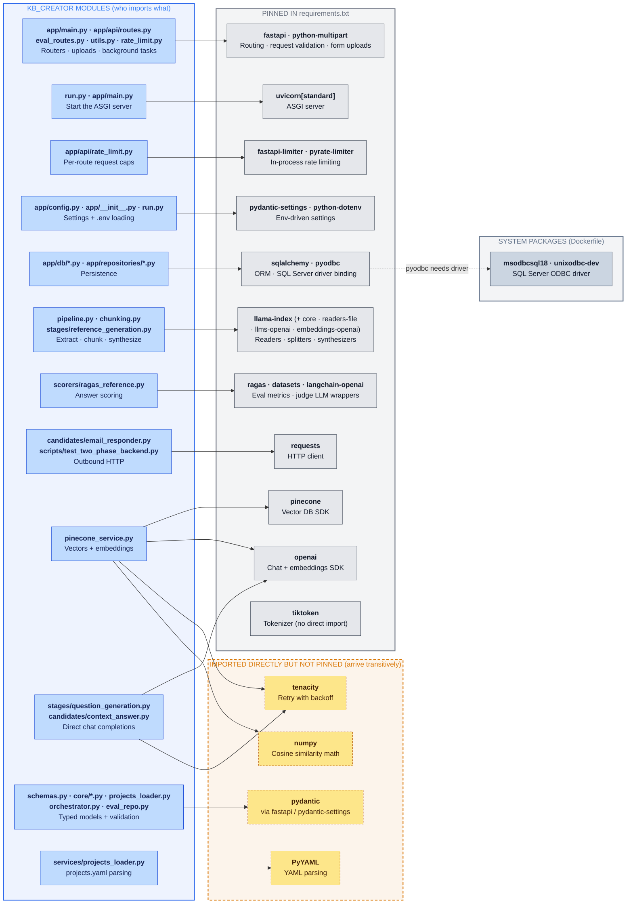

# KB_Creator — Architecture Diagram

KB_Creator is a FastAPI service that turns uploaded documents into an ai_utilities-compatible Pinecone knowledge base. It generates ground-truth Q/A pairs, builds three chunking versions, scores them with Ragas, and commits the winning version to the program namespace.

> **Viewing:** Both diagrams render on GitHub and in the VS Code Markdown preview (with the *Markdown Preview Mermaid Support* extension). The component map is wide. In VS Code, hold **Alt** and scroll to zoom or drag to pan. On GitHub, use the diagram's zoom controls.

## 1. Component map

```mermaid
---
config:
  flowchart:
    wrappingWidth: 420
---
flowchart TB

  subgraph CLIENTS["EXTERNAL CALLERS"]
    FE["<b>K4kAiConsole</b> (frontend)<br/>Upload docs · review GT · poll status"]
    CALLER["<b>Service callers</b><br/>Start + poll generic eval jobs"]
  end

  subgraph DEPLOY["BUILD + DEPLOY"]
    GHA["<b>.github/workflows/</b><br/>master → prod ECS · dev → dev ECS"]
    DOCKER["<b>Dockerfile</b><br/>Python 3.11 + MS ODBC 18<br/>· uvicorn :8000"]
  end

  subgraph BOOT["APP BOOTSTRAP — entry points"]
    RUN["<b>run.py</b><br/>Local dev launcher<br/>· uvicorn --reload :8001"]
    INIT["<b>app/__init__.py</b><br/>Loads .env before settings"]
    MAIN["<b>app/main.py</b><br/>Creates FastAPI app · CORS · mounts routers<br/>· imports plugin pkgs (fills registry) · GET /"]
  end

  subgraph CONFIG["CONFIG FILES"]
    ENV["<b>.env</b> (git-ignored) · <b>.env.example</b><br/>API keys · DB URL · tunables"]
    YAML["<b>config/projects.yaml</b><br/>Eval project registry"]
  end

  subgraph PUBLIC["PUBLIC API LAYER — HTTP endpoints · app/api/"]
    ROUTES["<b>routes.py</b> — KB pipeline router<br/>──────────<br/>POST /kb/create · Phase 1 upload + extract<br/>POST /kb/jobs/{id}/generate-gt · Phase 2 build GT<br/>POST /kb/jobs/{id}/continue · Phase 3 chunk + eval<br/>POST /kb/jobs/{id}/retry-extract · redo failed docs<br/>GET /kb/status/{id} · GET /kb/jobs · poll + list<br/>DELETE /kb/jobs/{id} · delete job<br/>GET /health · config check"]
    EVROUTES["<b>eval_routes.py</b> — generic eval router<br/>──────────<br/>POST /eval/jobs · start eval job<br/>POST /eval/projects/{id}/run · same, by project<br/>GET /eval/jobs/{id} · status + artifacts<br/>POST /eval/jobs/{id}/resume · resume paused job"]
    SCHEMAS["<b>schemas.py</b><br/>Pydantic request /<br/>response contracts"]
  end

  subgraph PRIVATE["PRIVATE API LAYER — internal helpers, no HTTP route · app/api/"]
    UTILS["<b>utils.py</b><br/>Upload validation · text extraction<br/>· job records · status builder<br/>· background thread pool"]
    RATE["<b>rate_limit.py</b><br/>Per-route request caps<br/>(per client IP, per minute)"]
  end

  subgraph SERVICES["SERVICE LAYER — pipeline + orchestration · app/services/"]
    PIPE["<b>pipeline.py</b><br/>run_pipeline: build GT, then pause<br/>run_pipeline_continue: chunk ×3, evaluate"]
    ORCH["<b>orchestrator.py</b><br/>Staged engine: cases → answers<br/>→ scored → decided → commit"]
    RECIPE["<b>recipes/kb_version.py</b><br/>Wires KB-version JobConfig<br/>· commit = upsert winner"]
    PLOAD["<b>projects_loader.py</b><br/>projects.yaml → JobConfig"]
    REG["<b>registry.py</b><br/>Plugin register /<br/>resolve by name"]
    PAUSE["<b>pause.py</b><br/>paused_at:{stage}<br/>status helper"]
  end

  subgraph PLUGINS["EVAL PLUGINS — implement core/protocols.py · self-register in registry.py"]
    subgraph P_SRC["sources/ + stages/"]
      SRC["<b>sources/corpus_synthetic.py</b><br/>Source: docs → TestCaseSet"]
      QGEN["<b>stages/question_generation.py</b><br/>Stratified test questions"]
      RGEN["<b>stages/reference_generation.py</b><br/>Full-corpus reference answers"]
    end
    subgraph P_CAND["candidates/"]
      CER["<b>email_responder.py</b><br/>Answers via EmailResponder<br/>(used by KB flow)"]
      CPD["<b>pinecone_direct.py</b><br/>Pinecone query + LLM<br/>(baseline, not wired)"]
      CIM["<b>in_memory.py</b><br/>Local cosine + LLM<br/>(unregistered, not wired)"]
      CCA["<b>context_answer.py</b><br/>Shared grounded-answer<br/>LLM call"]
    end
    subgraph P_SCORE["scorers/"]
      SRR["<b>ragas_reference.py</b><br/>Ragas answer_correctness<br/>+ diagnostics"]
      SAC["<b>aspect_critic.py</b><br/>Stub, not implemented"]
    end
    subgraph P_DEC["deciders/"]
      DAA["<b>aggregate_argmax.py</b><br/>Highest mean score wins<br/>· fallback v2"]
    end
  end

  subgraph KBUTIL["KB BUILD UTILITIES · app/services/"]
    CHUNK["<b>chunking.py</b><br/>v1 small chunks · v2 + AI titles<br/>· v3 semantic split"]
    PINE["<b>pinecone_service.py</b><br/>Embed · upsert · query · delete ns<br/>· ai_utilities metadata schema"]
  end

  subgraph DATA["DATA ACCESS LAYER"]
    subgraph REPOS["app/repositories/"]
      JR["<b>job_repo.py</b><br/>CRUD kb_creator_job"]
      DR["<b>doc_repo.py</b><br/>CRUD kb_creator_docs"]
      ER["<b>eval_repo.py</b><br/>Stage artifacts · DB,<br/>or memory for dry-run"]
    end
    subgraph DBPKG["app/db/"]
      SESS["<b>session.py</b><br/>Engine · pool<br/>· session_scope()"]
      ORM["<b>orm.py</b><br/>Models: Job · Doc<br/>· EvalArtifact"]
    end
    MIG["<b>scripts/migrations/*.sql</b><br/>Schema changes 001–003<br/>(applied by hand)"]
  end

  subgraph EXTERNAL["EXTERNAL SERVICES"]
    OPENAI["<b>OpenAI API</b><br/>gpt-4.1 · 4.1-mini · 4o-mini<br/>· text-embedding-3-large"]
    PCX["<b>Pinecone index</b><br/>temp eval ns {job}_{v}<br/>· prod program ns"]
    SQL["<b>SQL Server (AWS RDS)</b><br/>kb_creator_job · kb_creator_docs<br/>· eval_artifact"]
    ERSVC["<b>EmailResponder</b><br/>/knowledgebase/manager-query"]
    AIU["<b>ai_utilities</b><br/>Serves program ns in prod"]
  end

  subgraph FOUNDATION["SHARED FOUNDATION — imported by every layer (lines omitted)"]
    CFG["<b>config.py</b><br/>Typed settings from .env<br/>· chunk presets"]
    STATE["<b>state.py</b><br/>In-memory job_meta<br/>+ per-job locks"]
    TYPES["<b>core/types.py</b><br/>JobStatus / JobStage enums<br/>· stage artifact models"]
    PROTO["<b>core/protocols.py</b><br/>Plugin contracts<br/>· JobConfig · JobContext"]
    EMOD["<b>core/eval_models.py</b><br/>MetricBundle<br/>· WinnerPolicy"]
  end

  subgraph TOOLING["REPO TOOLING + REFERENCE (not loaded at runtime)"]
    TESTS["<b>scripts/test_*.py</b><br/>Mocked dry-run test<br/>· live E2E test"]
    DOCS["<b>README.md</b> · <b>AI_UTILITIES_…SYNTHESIS.md</b><br/>Usage guide · Pinecone schema spec"]
    GTJSON["<b>evaluation/ground_truth.json</b><br/>Sample Q/A set (unused)"]
    DEVCFG["<b>pyrightconfig.json</b> · <b>.python-version</b><br/>Type checking · Python 3.11"]
  end

  %% ── callers + bootstrap ──
  FE ==>|"HTTP /kb/*"| ROUTES
  CALLER ==>|"HTTP /eval/*"| EVROUTES
  GHA -->|"build → ECR → ECS"| DOCKER
  DOCKER -->|"uvicorn app.main:app"| MAIN
  RUN -->|launches| MAIN
  INIT -.->|load_dotenv| ENV
  MAIN -->|include_router| ROUTES
  MAIN -->|include_router| EVROUTES

  %% ── public API ──
  ROUTES --> SCHEMAS
  EVROUTES --> SCHEMAS
  ROUTES -->|"rate-limit deps"| RATE
  ROUTES -->|helpers| UTILS
  EVROUTES -->|"shared thread pool"| UTILS
  ROUTES -->|"job reads / updates"| JR
  EVROUTES -->|get_project| PLOAD
  EVROUTES -->|run_eval_job| ORCH

  %% ── private API ──
  UTILS -->|"background: run_pipeline<br/>/ run_pipeline_continue"| PIPE
  UTILS -->|"store extracted docs"| DR

  %% ── service layer ──
  PIPE -->|"Phase 2: generate GT"| SRC
  PIPE -->|"Phase 3: chunk ×3"| CHUNK
  PIPE -->|"upsert eval ns"| PINE
  PIPE -->|"build JobConfig"| RECIPE
  PIPE -->|run_eval_job| ORCH
  ORCH --> PAUSE
  ORCH -->|"① load cases"| SRC
  ORCH -->|"② answer"| CER
  ORCH -->|"③ score"| SRR
  ORCH -->|"④ decide"| DAA
  ORCH -->|"save / load artifacts"| ER
  RECIPE -->|resolve| REG
  PLOAD -->|resolve| REG
  PLOAD -.->|reads| YAML
  RECIPE -->|"⑤ commit: upsert winner,<br/>delete eval ns"| PINE

  %% ── plugin internals ──
  SRC --> QGEN
  SRC --> RGEN
  SRC -->|"load docs"| DR
  CPD --> CCA
  CIM --> CCA

  %% ── data access ──
  JR & DR & ER --> SESS
  JR & DR & ER --> ORM
  SESS ==>|pyodbc| SQL
  MIG -.->|"ALTER / CREATE"| SQL

  %% ── external services ──
  CHUNK ==>|"titles · semantic split"| OPENAI
  PINE ==>|embeddings| OPENAI
  PINE ==>|"upsert · query · delete"| PCX
  QGEN ==> OPENAI
  RGEN ==> OPENAI
  CCA ==> OPENAI
  SRR ==>|"judge LLM"| OPENAI
  CER ==>|HTTP| ERSVC
  ERSVC ==>|"queries eval ns"| PCX
  AIU ==>|"reads program ns"| PCX

  %% ── layout only (invisible) ──
  SQL ~~~ CFG
  PCX ~~~ TESTS

  %% ── styles ──
  classDef client   fill:#e5e7eb,stroke:#374151,color:#111827
  classDef boot     fill:#e2e8f0,stroke:#334155,color:#0f172a
  classDef pub      fill:#bbf7d0,stroke:#15803d,color:#052e16
  classDef priv     fill:#fde68a,stroke:#b45309,color:#422006
  classDef svc      fill:#bfdbfe,stroke:#1d4ed8,color:#172554
  classDef plugin   fill:#ddd6fe,stroke:#6d28d9,color:#2e1065
  classDef util     fill:#a5f3fc,stroke:#0e7490,color:#083344
  classDef core     fill:#99f6e4,stroke:#0f766e,color:#042f2e
  classDef data     fill:#fed7aa,stroke:#c2410c,color:#431407
  classDef file     fill:#fef9c3,stroke:#a16207,color:#422006
  classDef ext      fill:#fecdd3,stroke:#be123c,color:#4c0519
  classDef deploy   fill:#cbd5e1,stroke:#475569,color:#0f172a
  classDef inactive fill:#f3f4f6,stroke:#9ca3af,color:#4b5563,stroke-dasharray:4 3

  class FE,CALLER client
  class RUN,INIT,MAIN boot
  class ROUTES,EVROUTES,SCHEMAS pub
  class UTILS,RATE priv
  class PIPE,ORCH,RECIPE,PLOAD,REG,PAUSE svc
  class SRC,QGEN,RGEN,CER,CCA,SRR,DAA plugin
  class CPD,CIM,SAC inactive
  class CHUNK,PINE util
  class CFG,STATE,TYPES,PROTO,EMOD core
  class JR,DR,ER,SESS,ORM,MIG data
  class ENV,YAML,TESTS,DOCS,GTJSON,DEVCFG file
  class OPENAI,PCX,SQL,ERSVC,AIU ext
  class GHA,DOCKER deploy

  style CLIENTS    fill:#6b728014,stroke:#6b7280,stroke-width:2px,color:#6b7280
  style DEPLOY     fill:#64748b14,stroke:#64748b,stroke-width:2px,color:#64748b
  style BOOT       fill:#64748b14,stroke:#64748b,stroke-width:2px,color:#64748b
  style CONFIG     fill:#ca8a0414,stroke:#ca8a04,stroke-width:2px,color:#ca8a04
  style PUBLIC     fill:#16a34a14,stroke:#16a34a,stroke-width:2px,color:#16a34a
  style PRIVATE    fill:#d9770614,stroke:#d97706,stroke-width:2px,color:#d97706
  style SERVICES   fill:#2563eb14,stroke:#2563eb,stroke-width:2px,color:#3b82f6
  style PLUGINS    fill:#7c3aed14,stroke:#7c3aed,stroke-width:2px,color:#8b5cf6
  style P_SRC      fill:#7c3aed14,stroke:#8b5cf6,color:#8b5cf6
  style P_CAND     fill:#7c3aed14,stroke:#8b5cf6,color:#8b5cf6
  style P_SCORE    fill:#7c3aed14,stroke:#8b5cf6,color:#8b5cf6
  style P_DEC      fill:#7c3aed14,stroke:#8b5cf6,color:#8b5cf6
  style KBUTIL     fill:#0891b214,stroke:#0891b2,stroke-width:2px,color:#0891b2
  style DATA       fill:#ea580c14,stroke:#ea580c,stroke-width:2px,color:#ea580c
  style REPOS      fill:#ea580c14,stroke:#f97316,color:#ea580c
  style DBPKG      fill:#ea580c14,stroke:#f97316,color:#ea580c
  style EXTERNAL   fill:#e11d4814,stroke:#e11d48,stroke-width:2px,color:#e11d48
  style FOUNDATION fill:#0d948814,stroke:#0d9488,stroke-width:2px,color:#0d9488
  style TOOLING    fill:#ca8a0414,stroke:#ca8a04,stroke-width:2px,stroke-dasharray:6 4,color:#ca8a04
```

### How to read it

| Element | Meaning |
| --- | --- |
| Box | One file or module, or one external system |
| Outlined group | A layer or folder (compartment) |
| Thin solid arrow | In-process call or import |
| **Thick** arrow | Network call (HTTP, vendor SDK, DB driver) |
| Dotted arrow | Reads a config file, or a schema change applied by hand |
| Grey dashed box | Code that exists but is not wired into the live flow |
| ① – ⑤ | Order in which `orchestrator.py` runs the eval stages |
| Phase 1 – 3 | Follow the API's numbering: `create` → `generate-gt` → `continue` |

Arrows show the main call paths, not every import. The **Shared foundation** group is imported by almost every module, so its arrows are left out.

**Public vs private API layer**

- **Public API layer:** the HTTP endpoints on the two FastAPI routers, plus `schemas.py`, which defines what goes over the wire. Clients can call anything in this layer.
- **Private API layer:** `app/api/utils.py` and `app/api/rate_limit.py`. These are Python helpers that the route handlers call. They have no route, so they can't be reached over HTTP. Functions whose names start with `_` follow the same rule inside each module.

## 2. Third-party packages

This shows which modules import which packages, and where each package comes from.

